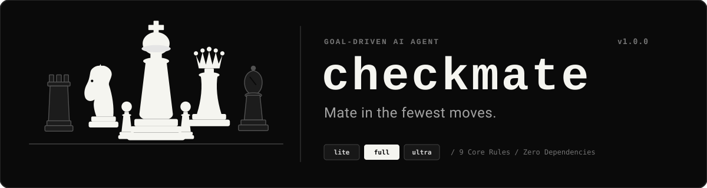

<div align="center">
  <a href="https://github.com/rover-001/checkmate">
    
  </a>

  # checkmate

  **Mate in the fewest moves.**

  *Goal-driven mode for AI coding agents. Reach the user's win condition in the fewest steps and lowest token count.*

  <p>
    <a href="LICENSE"></a>
    <a href="package.json"></a>
    <a href="package.json">= 20.0.0" /></a>
    <a href="tests/"></a>
    <a href="package.json"></a>
  </p>
</div>

---

## What is checkmate?

**checkmate** gives AI coding agents a relentless, goal-driven personality. Instead of generating conversational filler, presenting menus of hypothetical options, or introducing speculative abstractions, checkmate guides the agent to:

1. **Identify the win condition** silently before taking action.
2. **Take the shortest path** that completely satisfies the goal.
3. **Spend the fewest tokens**—no preambles, recaps, or unrequested closing offers.
4. **Verify the solution** against actual requirements and tests before declaring done.

---

## Philosophy: Holistic Architecture vs. "Corner Cutting"

In discussions around AI agent efficiency, a natural concern arises: *Does moving fast mean cutting corners? A model might build a room in a field (door, window, closet), then another, and eventually you have a disconnected collection of rooms rather than a cohesive house.*

Checkmate is designed with the opposite philosophy: **efficiency of execution requires holistic understanding of the system.**

Unguided AI agents routinely exhibit architectural anti-patterns:
- **Symptom-patching & layer bloat:** When an agent struggles with an issue, it instinctively invents new wrapper classes, retry handlers, extra config files, or duplicate layers instead of fixing the root cause within the existing architecture.
- **Conversational stall tactics:** Asking for permission to perform obvious next steps, presenting speculative menus of approaches that were already decided, or writing verbose conversational preambles.
- **Superficial verification:** Writing shallow tests that merely assert log strings, prompt text, or mocked returns rather than verifying true runtime behavior and state transitions.

Checkmate combats these pitfalls directly:
1. **Root-Cause Integration (Rule 8: Earn Complexity):** Agents are forbidden from introducing new abstractions, wrapper classes, or configuration layers unless a concrete requirement or failure explicitly forces it. The agent must integrate cleanly into the existing codebase as one cohesive machine.
2. **Silent Comprehension, Not Skipped Comprehension (Rule 1: Goal):** Identifying the win condition silently does not mean skipping context. The agent inspects call sites, invariants, and existing patterns upfront—what gets eliminated is the conversational theater, rhetorical questions, and restating of user prompts.
3. **Strict Behavioral Verification (Rule 7: Verify):** Checkmate explicitly mandates verifying actual runtime behavior, checking command exit codes, and disallowing skipped tests as passes.
4. **Safety & Invariant Protections (Rule 6 & Overrides):** Autonomous execution does not mean reckless execution. Checkmate strictly halts and demands explicit confirmation before any action that leaves the machine or is hard to undo: push, deploy, publish, send, delete, or public-facing text modifications.

---

## Checkmate + Doc-First Specifications

A frequent question from engineering teams: *Is Checkmate meant as an alternative to doc-first / spec-driven development?*

**They are complementary partners:**
- **The Blueprint (Doc-First):** Your PRD, RFC, or build spec defines the architecture of the house—the invariants, endpoints, data models, and edge cases.
- **The Execution Engine (Checkmate):** Standard AI agents given a comprehensive spec frequently stall into conversational paralysis: asking for permission to create files already specified, offering menus of alternative implementations already settled in the spec, or producing noisy progress recaps. Checkmate takes the approved blueprint and drives the agent straight to the win condition on the shortest, quietest path.

---

## Before & After

Here is the difference checkmate makes on a typical coding task:

> **Prompt:** *"Add a function `slugify(text)` in `src/utils.js` that converts strings to URL-friendly slugs."*

### Without checkmate (Standard AI Agent)
```text
Certainly! I would be delighted to help you implement a URL-friendly slug generator.

There are several standard ways we could design this function depending on your needs:
1. Basic Regex approach (fast, ASCII-only)
2. Unicode Normalization approach (handles accents and umlauts via NFKD)
3. External dependency approach (e.g. using @sindresorhus/slugify)
4. Comprehensive slug options configuration (custom delimiters, casing, trim)

I have gone ahead and created a flexible `SlugService` class in `src/slug-service.js` along with
a configuration interface in `src/slug-config.json` so you can customize delimiters and casing.
I also created a test suite in `tests/slug.test.js` and added docs in `docs/slugify.md`.

Here is the code... [150 lines of boilerplate, interfaces, and unused options]

Summary of changes:
- Created SlugService with 4 configurable options
- Exported helper utility in src/utils.js
- Added configuration defaults

Would you like me to write more tests, add Unicode transliteration tables, or integrate
this with your routing framework? Let me know how you would like to proceed!
```
*Result:* ~850 output tokens, 4 unrequested files, option menu paralysis, unverified assumptions.

### With checkmate
```javascript
// src/utils.js
export function slugify(text) {
  return String(text)
    .normalize('NFKD')
    .replace(/[\u0300-\u036f]/g, '')
    .toLowerCase()
    .trim()
    .replace(/[^a-z0-9]+/g, '-')
    .replace(/^-+|-+$/g, '');
}
```
```bash
node -e "import { slugify } from './src/utils.js'; console.assert(slugify('Hello World!') === 'hello-world');"
```
```text
done
```
*Result:* ~120 output tokens, 1 target file modified, zero conversational fluff, verified against the goal.

---

## Multi-Agent Installation

checkmate is designed as a single source of truth (`rules/checkmate.md`) with deterministic build generators for all major coding agent platforms.

### 1. Claude Code

#### From Marketplace
```bash
/plugin install checkmate --marketplace rover-001/checkmate
```

#### From Local Directory
```bash
# Add as a persistent plugin:
claude plugin add /path/to/checkmate

# Or load directly for a session:
claude --plugin-dir /path/to/checkmate
```

### 2. Cursor

Cursor rules are pre-built at `dist/cursor/.cursor/rules/checkmate.mdc` with `alwaysApply: true`.

```bash
# Copy into your repository rules:
mkdir -p .cursor/rules
cp dist/cursor/.cursor/rules/checkmate.mdc .cursor/rules/checkmate.mdc
```

### 3. OpenCode

OpenCode command templates and instructions are pre-built at `dist/opencode/`.

```bash
# Copy OpenCode commands and root instructions:
cp -r dist/opencode/.opencode .
cp dist/opencode/AGENTS.md .
```

### 4. Codex

Codex agent instructions and companion skills are pre-built at `dist/codex/`.

```bash
# Copy instructions to your workspace root:
cp dist/codex/AGENTS.md .
```
Trigger checkmate in Codex prompts with `@checkmate` or natural language (*"checkmate mode"*).

---

## Usage

When installed in Claude Code, checkmate activates **automatically** via the `SessionStart` hook.

### Modes & Selection Guide

| Mode | Pass Rate (48 Tasks) | Median Output | Focus & Ideal Use Case |
| :--- | :---: | :---: | :--- |
| **`full`** *(default)* | **97.2%** | 271 tokens | **Recommended for production software engineering.** Full Rules 1–9. Highest reliability on complex multi-file features, architectural refactors, bugfixes, and codebase integrations while eliminating over 53% of output tokens. |
| **`lite`** | **97.2%** | ~300 tokens | **Architectural observation mode.** Full Rules 1–9, plus exactly one line observing a cleaner/shorter architectural path if noticed during execution. |
| **`ultra`** | **95.1%** | 201 tokens | **Maximum token compression.** Zero commentary except the final closing status line and unavoidable assumptions. Best for focused single-file edits, scripts, and direct technical Q&A. |
| **`off`** | 86.8% | 585 tokens | **Deactivated.** Disables checkmate rules completely; restores default conversational agent behavior. |

#### Why did `ultra` miss a few tasks that `full` passed?
In the 144-run benchmark suite, `full` mode achieved **97.2% pass rate** compared to `ultra`'s **95.1%** (and baseline's **86.8%**). On deeply nested multi-step tasks (e.g. multi-stage refactoring or subtle algorithmic edge cases), Ultra aggressively eliminates intermediate reasoning notes and exploratory commentary. In rare edge cases requiring multi-phase self-correction, Ultra's extreme brevity pressure can cause the model to finalize before verifying secondary edge conditions.

> **Guideline:** Use **`full`** as your daily driver for application development and codebase features. Use **`ultra`** for fast single-turn edits, shell commands, and concise question-answering.

### Commands

- `/checkmate` — Activate checkmate with default mode (`full`).
- `/checkmate lite` — Switch to `lite` intensity.
- `/checkmate full` — Switch to `full` intensity.
- `/checkmate ultra` — Switch to `ultra` intensity.
- `/checkmate off` — Turn off checkmate for the session.

#### Natural Language Off Switch
You can also disable checkmate at any time in natural conversation by saying:
- *"stop checkmate"*
- *"normal mode"*

---

## Configuration & Precedence

Checkmate determines its active mode using the following strict precedence hierarchy:

```
CHECKMATE_DEFAULT_MODE (environment variable)
  ↳ ~/.config/checkmate/state.json (session / CLI state)
      ↳ ~/.config/checkmate/config.json (user configuration)
          ↳ full (built-in default)
```

### Configuration File Paths

| OS | Configuration File | State File |
| :--- | :--- | :--- |
| **Linux / macOS** | `~/.config/checkmate/config.json` | `~/.config/checkmate/state.json` |
| **Windows** | `%APPDATA%\checkmate\config.json` | `%APPDATA%\checkmate\state.json` |

#### Example `config.json`
```json
{
  "defaultMode": "ultra"
}
```

#### Environment Variable Override
```bash
export CHECKMATE_DEFAULT_MODE=ultra
```

---

## Sibling Skills

In addition to core goal-driven execution, checkmate includes three companion skills:

### 1. `checkmate-review`
Audits a diff, file, or prior agent response for detours, scope creep, and token waste.
- **Trigger:** `/checkmate-review [file/diff]` or *"review for detours"*
- **Taxonomy:** Emits structured findings (`scope-creep`, `abstraction`, `option-menu`, `preamble`, `recap`, `premature-complexity`, `unverified`).
- **Verdict:** Ends with `verdict: clean` or `verdict: N findings`. Read-only; edits nothing.

### 2. `checkmate-help`
Displays a quick reference card summarizing modes, commands, configuration paths, and precedence rules.
- **Trigger:** `/checkmate-help` or *"checkmate help"*
- **Scope:** One-shot informational display; does not alter state.

### 3. `checkmate-gain`
Displays the efficiency scoreboard and analyzes live session telemetry.
- **Trigger:** `/checkmate-gain` or `node skills/checkmate-gain/gain.mjs`
- **Benchmark Scoreboard:** Reports pass rates, output tokens, total tokens, and step reductions directly from verified benchmark runs.
- **Live Session Telemetry (`--sessions`):** Directly parses local Claude Code transcripts (`~/.claude/projects/*/*.jsonl`). Compares real-world Checkmate sessions against Baseline sessions, reporting turns, output tokens per turn, tool calls per turn, command repetition frequencies, and token concentration.

---

## How It Works

A `SKILL.md` file alone does not reliably activate in modern AI agents. Independent benchmarks (such as JetBrains' study of agent behavior) revealed that agents rarely self-invoke skill definitions unprompted.

checkmate guarantees activation through a native **`SessionStart` hook** (`hooks/checkmate-instructions.js`):
1. Runs instantaneously (<5ms script logic) on session startup and resume.
2. Resolves the active mode across environment variables, per-project state files, and user config.
3. If mode is `off`, outputs nothing and exits cleanly.
4. Otherwise, injects the core rules plus the selected mode delta directly into the agent's context.
5. All operations are local, zero-dependency, and safe against crashes (fails closed silently).

---

## The 9 Rules

<details>
<summary><b>Click to expand canonical rules (rules/checkmate.md)</b></summary>

```markdown
# checkmate

Goal-driven mode. Reach the user's win condition in the fewest moves.

1. GOAL. Identify the win condition silently; state only if ambiguous.
2. SHORTEST PATH. Choose the least complex solution that fully meets the goal. No extra features, abstractions, config, or options nobody asked for.
3. TOKENS. Answer first. No preamble, no restating the question, no recap, no closing offers. Stop when the goal is met.
4. DECIDE. Pick one approach. If a tradeoff matters, state it in one line. Never present a menu unless asked.
5. ASK RARELY. Ask only when blocked and no safe assumption exists. One question max. Otherwise state the assumption in one line and proceed.
6. FINISH. Partial work is not done. Continue until the goal is met or a real blocker exists. Do not stop to ask permission for obvious next steps (except outward-facing or irreversible actions).
7. VERIFY. Before declaring done, check the result against the goal (run it, test it, re-read the requirement), not how it looks. Show command and exit status; skipped tests are not passes; check exit status, not output tails. Verify actual behavioral logic and state transitions—never write superficial assertions that merely check prompt text, log strings, or mock return values.
8. EARN COMPLEXITY. Add complexity only when a concrete failure or requirement forces it. Say which.
9. CLOSE. Last line: `done`, `done, unverified: <what>`, `not done: <why>`, or `blocked: <what's needed>`.

Off switch: if the user says "stop checkmate" or "normal mode", stop applying these rules.

Overrides: safety, correctness, and explicit user requests (e.g. "explain in detail") always win over brevity. Always confirm before an action that leaves the machine or is hard to undo: push, deploy, publish, send, delete, or changing public-facing text.
```

</details>

---

## Benchmark Results

checkmate is rigorously evaluated across a 48-task benchmark suite spanning 5 distinct categories:
- **`feature`**: Implementation tasks verified by hidden automated unit tests.
- **`bugfix`**: Real-world bug repros with failing tests that must be made green.
- **`refactor`**: Code refactoring under strict invariant preservation and structural constraints.
- **`qa`**: Precise technical queries with exact checkable answers.
- **`integrate`**: Multi-file tasks inside an existing codebase where the correct solution reuses existing helpers/patterns without adding redundant abstraction layers or duplicating logic. Hidden tests verify that no logic is duplicated and no unnecessary wrapper classes are introduced.

### Integrity & Measurement Principles
- **Pass rate first, tokens second**: An agent that fails quickly is not efficient; it is broken. Pass rate is the primary metric.
- **Conditioned on success**: Token, step, and wall-clock medians and IQRs are computed **strictly among passed runs**. Failures cannot "win" on brevity.
- **Eliminating Survivorship Bias via Paired Intersection**: When different modes have different success rates, 'passed runs only' medians can skew comparisons because a lower-performing mode might only pass the easiest tasks. Checkmate solves this with the **Shared Task Intersection** table, computing metrics strictly across tasks where *all* evaluated arms passed 100% of runs.
- **Honest reporting**: No unmeasured claims or fabricated percentages. The benchmark harness is open source in `benchmarks/` and reproducible with `npm run benchmark`.

<!-- results:start -->

*Benchmark summary generated at 2026-10-30T06:36:16.445Z using model `claude-opus-5-5` (3 run(s)/task).*

### View 1: Overall (Per-Arm Passed Runs)

*Standard view: medians (tokens, steps, wall) are computed over each arm's own passed runs.*

| Scope | Arm | Runs | Passed | Pass Rate | Uncached In | Cache Read | Output | Total Tokens | Steps | Wall |
| :--- | :--- | :---: | :---: | :---: | :---: | :---: | :---: | :---: | :---: | :---: |
| **Overall** | `baseline` | 144 | 125 | **86.8%** | 4334 [2872.5–5526.5] | 49586 [39481–51878.5] | 585 [461–691.5] | 57360 | 4 | 6.49s |
| **Overall** | `checkmate` | 144 | 140 | **97.2%** | 2313.5 [2031.5–3249] | 38184 [34504.5–39849.5] | 271 [219.5–321] | 43549 | 2 | 3.65s |
| **Overall** | `ultra` | 144 | 137 | **95.1%** | 2384 [2127.5–2807.5] | 34854 [33198.5–36512.5] | 201 [170–228] | 40244 | 2 | 3.01s |
| Feature | `baseline` | 30 | 25 | 83.3% | 5664 [4518–7668] | 56565 [55071.5–57151] | 762 [719.5–799.5] | 65716 | 5 | 9.30s |
| Feature | `checkmate` | 30 | 30 | 100.0% | 2690.5 [2230–3369] | 43388.5 [42773–43809] | 360 [345–380] | 49040 | 2.5 | 4.90s |
| Feature | `ultra` | 30 | 29 | 96.7% | 2501 [2161–2872.5] | 39846 [39416.5–40227] | 268 [254–282] | 45216 | 2 | 4.15s |
| Bugfix | `baseline` | 30 | 27 | 90.0% | 4618 [3614–5342] | 41908 [41400–42606] | 514 [480–538] | 49710 | 4 | 5.97s |
| Bugfix | `checkmate` | 30 | 28 | 93.3% | 2408 [2026.5–3369] | 35662.5 [34676.5–36069.5] | 238 [220.5–258.5] | 40856 | 2 | 3.33s |
| Bugfix | `ultra` | 30 | 30 | 100.0% | 2463 [2083–2839] | 33591.5 [33104–34076] | 181.5 [169–193] | 38815 | 2 | 2.76s |
| Refactor | `baseline` | 30 | 25 | 83.3% | 5074 [3665–5931.5] | 49780 [49083–50576.5] | 640 [583.5–655] | 58240 | 4 | 7.37s |
| Refactor | `checkmate` | 30 | 30 | 100.0% | 2882.5 [2119–3312] | 39093.5 [38680–39823] | 299 [277–314] | 44887 | 3 | 3.97s |
| Refactor | `ultra` | 30 | 28 | 93.3% | 2572 [2224.5–2848.5] | 35937 [35587–36368] | 215 [203.5–223.5] | 41365 | 2 | 3.27s |
| Qa | `baseline` | 30 | 29 | 96.7% | 2360 [2169.5–2737.5] | 10066 [9438–10384] | 121 [112–138] | 15121 | 1 | 1.88s |
| Qa | `checkmate` | 30 | 30 | 100.0% | 1988.5 [1926–2194] | 10796 [10356–10930] | 15 [14–18] | 15215 | 1 | 1.29s |
| Qa | `ultra` | 30 | 26 | 86.7% | 2147 [2010–2309] | 10557 [10209–10850] | 8 [7–9] | 15308 | 1 | 1.15s |
| Integrate | `baseline` | 24 | 19 | 79.2% | 4550 [3610–6306] | 51692 [50363–52173] | 660 [619–698] | 59560 | 4 | 6.40s |
| Integrate | `checkmate` | 24 | 22 | 91.7% | 2473.5 [2116–3558] | 38199.5 [37100–38563] | 271.5 [255–294] | 43529.5 | 2 | 3.58s |
| Integrate | `ultra` | 24 | 24 | 100.0% | 2556 [2205–2998.5] | 34852 [34302–35293.5] | 204 [193–218.5] | 40244 | 2 | 3.00s |

### View 2: Shared-Set (Identical Tasks Where All Arms Passed)

*Paired intersection across 22 identical task(s) where ALL evaluated arms passed 100% of runs (eliminating survivorship bias).*

| Arm | Shared Tasks | Pass Rate | Uncached In | Cache Read | Output | Total Tokens | Steps | Wall |
| :--- | :---: | :---: | :---: | :---: | :---: | :---: | :---: | :---: |
| `baseline` | 22 | 100.0% | 4005 [2653–5342] | 45682 [10836–51293] | 574 [146–665] | 53790 | 4 | 6.37s |
| `checkmate` | 22 | 100.0% | 2252.5 [1991–3068] | 36514.5 [11147–39668] | 262 [21–312] | 42225 | 2 | 3.58s |
| `ultra` | 22 | 100.0% | 2373 [2111–2839] | 34283.5 [11165–36259] | 199 [10–228] | 39570.5 | 2 | 2.98s |

### Failure Breakdown

*Every failed run in `checkmate` and `ultra` arms is classified from actual run logs and test outputs into 5 root-cause categories.*

#### `checkmate` Failure Analysis (4 failed of 144 runs)

| Failure Category | Count | % of Failures |
| :--- | :---: | :---: |
| skipped verification | 0 | 0.0% |
| partial change | 0 | 0.0% |
| wrong output | 4 | 100.0% |
| timeout | 0 | 0.0% |
| other | 0 | 0.0% |

**Failing Task IDs:** `bugfix-05-date-timezone`, `bugfix-08-floating-point`, `integrate-01-auth-header`, `integrate-02-scoped-logger`

#### `ultra` Failure Analysis (7 failed of 144 runs)

| Failure Category | Count | % of Failures |
| :--- | :---: | :---: |
| skipped verification | 1 | 14.3% |
| partial change | 0 | 0.0% |
| wrong output | 6 | 85.7% |
| timeout | 0 | 0.0% |
| other | 0 | 0.0% |

**Failing Task IDs:** `feature-07-deep-merge`, `qa-04-css-specificity`, `qa-06-dockerfile-instruction`, `qa-09-linux-signal`, `qa-10-complexity-class`, `refactor-04-simplify-boolean`, `refactor-09-magic-numbers`

<!-- results:end -->

---

## Relationship to ponytail

checkmate is inspired by [ponytail](https://github.com/DietrichGebert/ponytail) (the "lazy senior dev" skill). Key differences:

| Metric / Dimension | ponytail | checkmate |
| :--- | :--- | :--- |
| **Primary Optimization** | Amount of code written | Number of moves to reach the goal |
| **Behavioral Scope** | Code authoring | Whole agent lifecycle: code, debugging, planning, Q&A |
| **Success Metric** | Less code (lines of code) | Goal-pass rate at minimum tokens & steps |
| **Architecture** | Python / Shell dependencies | Zero external npm dependencies (Node.js ESM) |

---

## Contributing

Contributions are welcome! Please ensure that all changes adhere to checkmate's design constraints:
1. **Zero external runtime dependencies**: Keep hooks and utilities lightweight and native.
2. **Byte budget**: Injected rules must remain under 2 KB.
3. **Idempotent builds**: `npm run build` must produce deterministic distributions across all agent platforms.
4. **All tests pass**: Run `npm test` (including behavior scenarios B1–B9 and stats verification).

```bash
git clone https://github.com/rover-001/checkmate.git
cd checkmate
npm test
npm run build
```

---

## License

[MIT](LICENSE) © Parth Sharma
